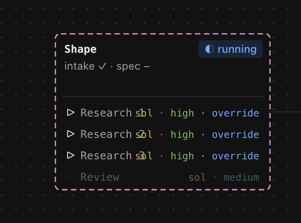

# Intent: Fix overlapping text in the Shape card

**Status: rough idea. Not shaped [human].**

## Problem
The Shape card shows overlapping text in its Research rows only when an
override is active. The combined settings text (`sol · high · override`)
becomes too long for the available row width and collides with the research
labels and numbers. The owner reported this as a minor UI issue.

## Evidence

## Expected result
Research labels, numbers, model names, effort levels, and override controls
remain readable and do not overlap at the card width shown in the screenshot,
including when an override is active and the settings text is longer.

Design and implementation are deferred until this item is picked up [human].
