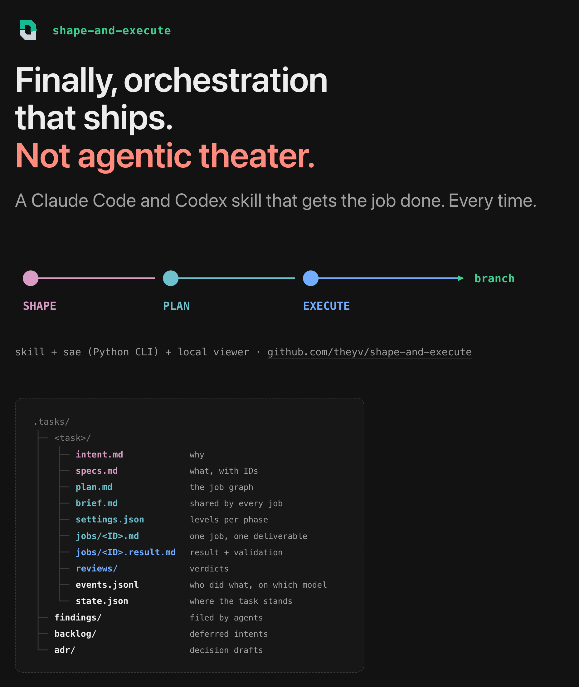
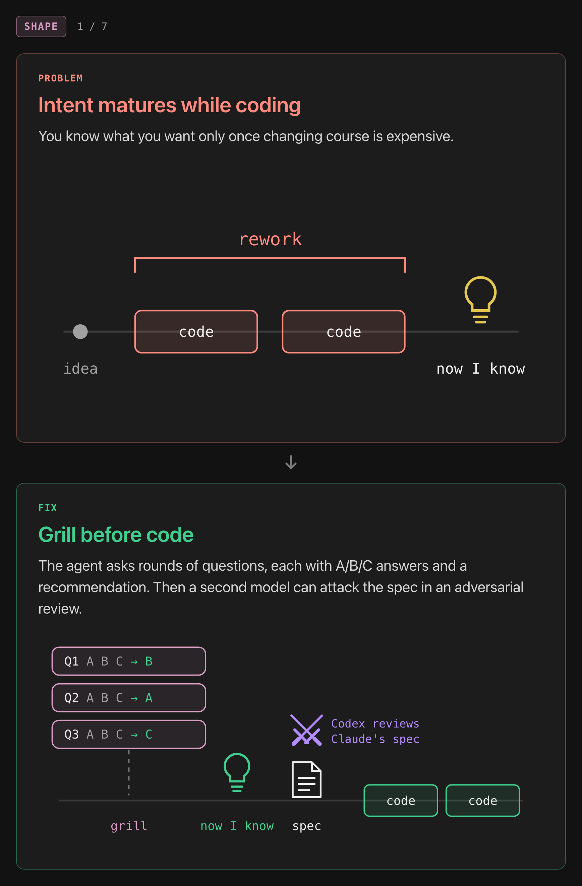
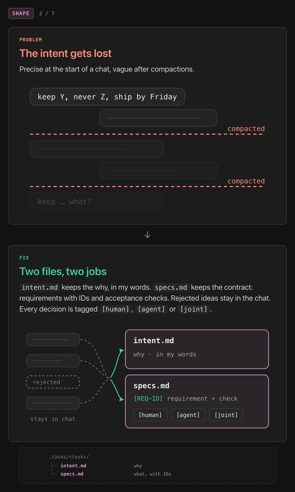
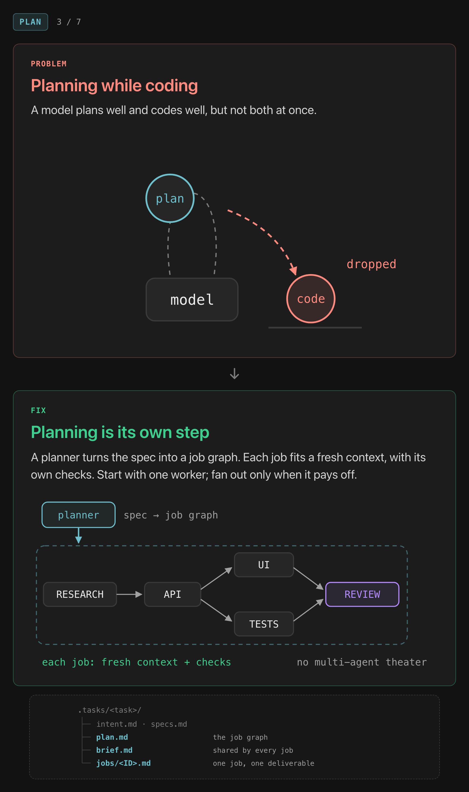
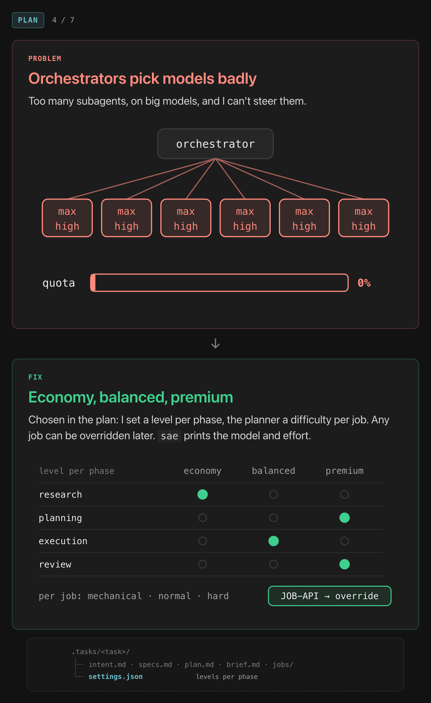
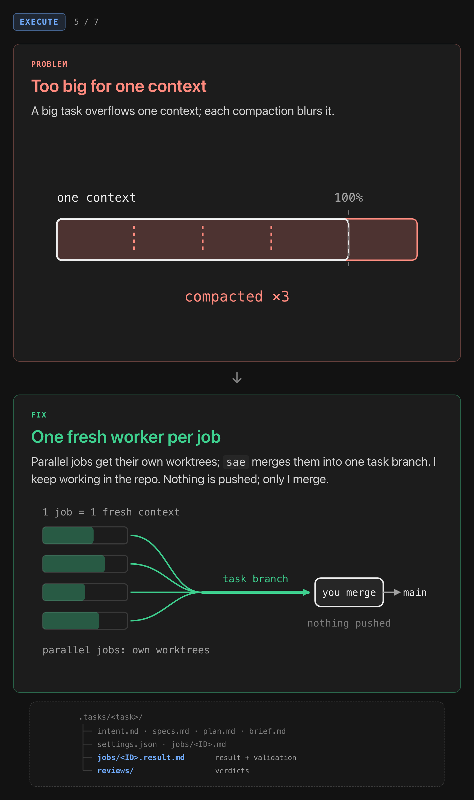
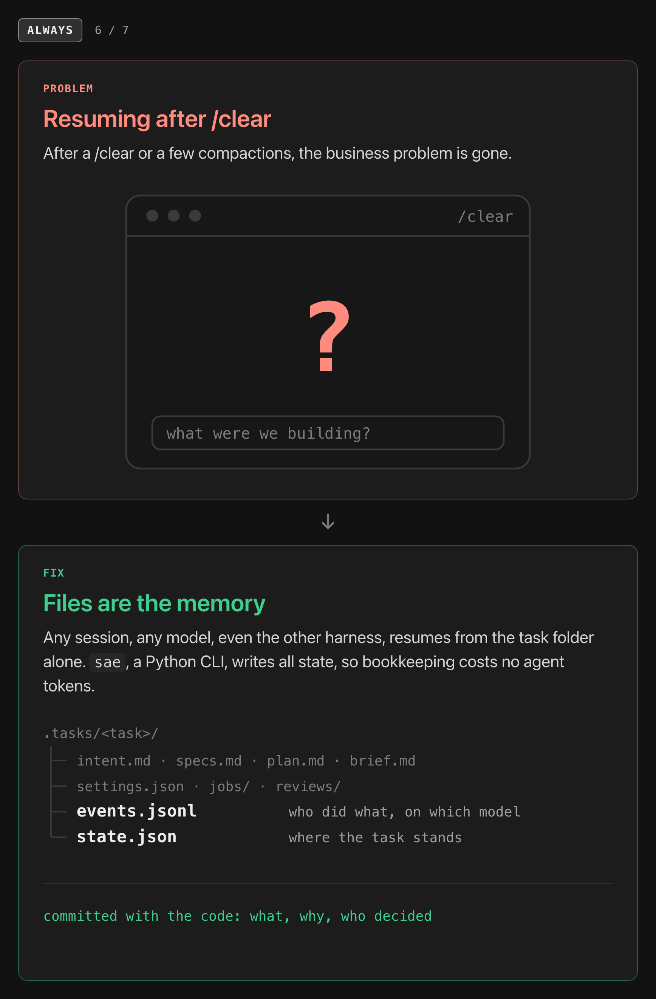
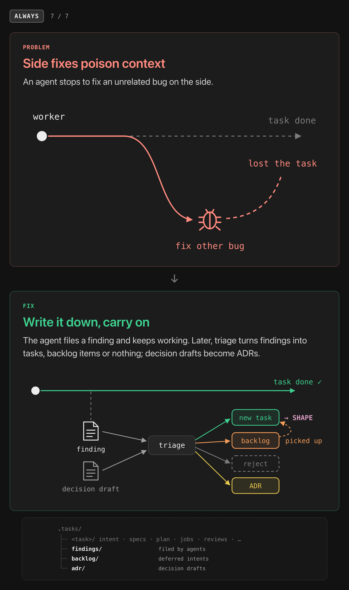
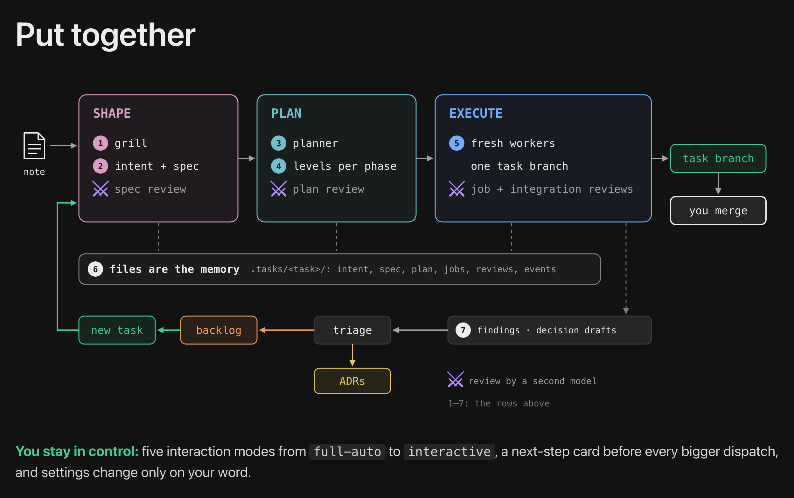
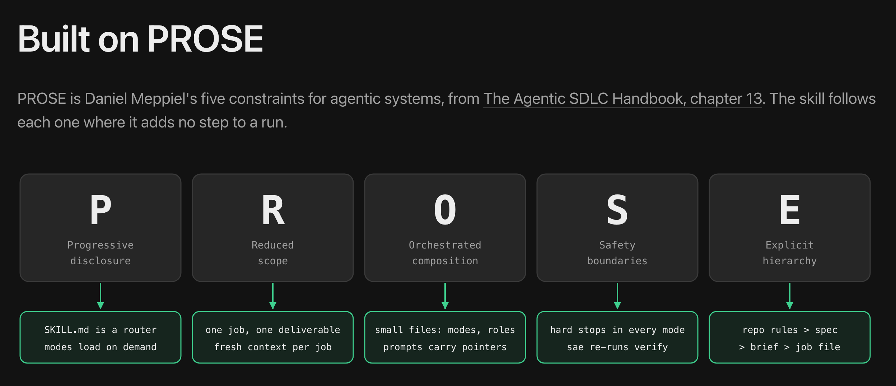

# shape-and-execute

Finally, orchestration that ships. Not agentic theater.
A Claude Code and Codex skill that gets the job done. Every time.



> **Early version.** The skill works and builds itself, but it is young: commands, files and
> defaults can still change. Evals are not done yet.

shape-and-execute takes a task from a rough note to a validated branch in three phases:
**shape** (intent and spec), **plan** (a graph of jobs) and **execute** (fresh workers, reviews,
one task branch). All state lives in files and goes through `sae`, a small Python CLI in the
skill. A local viewer shows the task, the plan and the settings.

## Install

Requirements: Python 3.9 or newer, git, and Claude Code or Codex. macOS and Linux.

With [APM](https://github.com/microsoft/apm), in a project:

```bash
apm install theyv/shape-and-execute/skills/shape-and-execute --target claude
```

For Codex, use `--target codex`. In a project without `.claude/` or another harness folder,
APM needs `--target`; without it, it stops with "No harness detected".

With the [skills CLI](https://www.npmjs.com/package/skills), in a project (add `-g` to install
for your user):

```bash
npx skills add theyv/shape-and-execute --skill shape-and-execute --agent claude-code -y
```

For Codex, use `--agent codex`. Without `--agent`, the CLI asks which agents to install to.

Claude Code gets the skill in `.claude/skills/shape-and-execute/`, Codex in
`.agents/skills/shape-and-execute/`. Both commands install only `skills/shape-and-execute/`.
The rest of this repository (tests, decision records, `.tasks/`) stays here.

## First run

The skill runs only when you call it.

```text
/shape-and-execute <a rough note of what you want>      # Claude Code
$shape-and-execute <a rough note of what you want>      # Codex
```

The first time, `sae` finds no user config and exits with code 2; the agent stops and offers
setup. Say yes (or run `/shape-and-execute setup`). Setup asks once:

- which models to use per harness, and how a phase level (economy, balanced, premium) and a job
  difficulty (mechanical, normal, hard) map to a model and an effort;
- the defaults for new tasks: the interaction mode, the review points and the review provider;
- the conversation language, the artifact language, the worktree root and the number of
  parallel writers;
- the harness permissions that worktrees and commits need (shown, applied only on your yes).

Without Codex, setup leaves Codex out and the reviews run on Claude. The config goes to
`~/.config/shape-and-execute/config.json` (`$XDG_CONFIG_HOME` or `$SAE_CONFIG` move it); the
skill itself holds no configuration. At the first task in a repository, setup also drafts
`.tasks/repo/profile.md` (validation commands, where decision records go). Then the agent goes
back to your note: grill questions, spec approval, plan approval, the jobs, and a task branch
for you to merge.

Other entries: `/shape-and-execute continue <task>`, `/shape-and-execute execute <task>`,
`/shape-and-execute triage`.

## How it works

Seven problems, seven fixes. Each row of the picture shows the problem on the left and the fix
on the right.

### 1. Shape: grill before code



You know what you want only once changing course is expensive. So the agent asks rounds of
questions, each with A/B/C answers and a recommendation. Then a second model can attack the
spec in an adversarial review.

### 2. Shape: two files, two jobs



An intent is precise at the start of a chat and vague after compactions. `intent.md` keeps the
why, in your words. `specs.md` keeps the contract: requirements with IDs and acceptance checks.
Rejected ideas stay in the chat. Every decision is tagged `[human]`, `[agent]` or `[joint]`.

### 3. Plan: planning is its own step



A model plans well and codes well, but not both at once. A planner turns the spec into a job
graph. Each job fits a fresh context, with its own checks. Start with one worker; fan out only
when it pays off.

### 4. Plan: economy, balanced, premium



Orchestrators spawn too many subagents, on big models, and you cannot steer them. Here you set
a level per phase in the plan, and the planner sets a difficulty per job. Any job can be
overridden later. `sae` prints the model and effort of every dispatch.

### 5. Execute: one fresh worker per job



A big task overflows one context, and each compaction blurs it. Parallel jobs get their own
worktrees; `sae` merges them into one task branch. You keep working in the repository. Nothing
is pushed; only you merge.

### 6. Always: files are the memory



After a `/clear` or a few compactions, the business problem is gone. Here any session, any
model, even the other harness, resumes from the task folder alone. `sae`, a Python CLI, writes
all state, so bookkeeping costs no agent tokens.

### 7. Always: write it down, carry on



An agent that stops to fix an unrelated bug on the side loses its own job. Here the agent files
a finding and keeps working. Later, triage turns findings into tasks, backlog items or nothing;
decision drafts become ADRs.

### Put together



A note goes through shape (grill, intent and spec, spec review), plan (planner, levels per
phase, plan review) and execute (fresh workers, one task branch, job and integration reviews)
to a task branch that you merge. The task folder holds intent, spec, plan, jobs, reviews and
events. Findings and decision drafts go to triage, and from there to the backlog, a new task or
ADRs.

You stay in control: five interaction modes from full-auto to interactive, a next-step card
before every bigger dispatch, and settings change only on your word.

### Built on five assumptions

1. **Decisions are mine.** Facts and implementation are the agents'.
2. **Quota is limited.** Not every step needs the biggest model.
3. **A contract before code.** A spec checked early is cheaper than fixing several jobs.
4. **Files outlive chats.** What is not written down is lost at the next compaction.
5. **Light in its complexity.** If a run needs bookkeeping, the tool failed.

The seven problems above follow from these.

### Built on PROSE



PROSE is Daniel Meppiel's five constraints for agentic systems, from The Agentic SDLC Handbook,
chapter 13. The skill follows each one where it adds no step to a run:

- **Progressive disclosure:** `SKILL.md` is a router; modes load on demand.
- **Reduced scope:** one job, one deliverable; a fresh context per job.
- **Orchestrated composition:** small files for modes and roles; prompts carry pointers.
- **Safety boundaries:** hard stops in every mode; `sae` re-runs each job's verify commands.
- **Explicit hierarchy:** repository rules > spec > brief > job file.

## Quotes of the user

When an agent quotes you in a task file, it smooths the quote (no curses, NSFW words or
personal data), and at each approval you review every new quote before it stays.

## Built with itself

This repository is developed with shape-and-execute. Its [`.tasks/`](.tasks/) folder is the
project's own work log: the backlog in `.tasks/backlog/`, the repository profile in
`.tasks/repo/`, and the task records of each new task. Decision records from triage go to
[`docs/adr/`](docs/adr/). Installs never copy `.tasks/`; it is here to show the process, not to
be used.

## Development

```bash
python3 tests/run.py
```

Runs the test suite from the repository root. See [AGENTS.md](AGENTS.md) for the layout and the
rules.

## Known issues

- Claude Code loads a user-level copy of a skill (`~/.claude/skills/shape-and-execute/`, or
  the `skills/` folder of `$CLAUDE_CONFIG_DIR`) before a project copy of the same name. Install
  the skill in one place only, or the project copy never runs.

## License

Apache-2.0, see [LICENSE](LICENSE). Credits for adapted work are in [CREDITS.md](CREDITS.md).

## For agents

shape-and-execute is an agent skill for Claude Code and Codex. Source: `skills/shape-and-execute/`
(entry `SKILL.md`, CLI `scripts/sae.py`, Python 3.9+, standard library only).

- Invocation is explicit only: `/shape-and-execute <note>` (Claude Code) or
  `$shape-and-execute <note>` (Codex); also `continue <task>`, `execute <task>`, `setup`,
  `triage`.
- Phases: shape (intake, optional research, grill rounds with A/B/C answers and a
  recommendation, `intent.md` and `specs.md`, optional spec review by a second model, spec
  approval); plan (a planner writes a job graph, each job sized for a fresh context with its own
  verify commands; levels per phase economy, balanced or premium; difficulty per job
  mechanical, normal or hard; plan review; plan approval); execute (one fresh worker per job,
  parallel jobs in their own git worktrees, merged into one task branch; job and integration
  reviews; the user merges).
- State: all task state is in `.tasks/<task>/` (intent, spec, plan, jobs, reviews, events) and
  is written only through `sae`. Any session or harness resumes from the task folder alone.
- Out-of-scope problems become findings (`sae finding new`); triage turns findings into tasks,
  backlog items or nothing, and decision drafts into ADRs.
- Control: five interaction modes (full-auto, auto, critical-only, collaborative,
  interactive); a next-step card before bigger dispatches; settings change only on the user's
  word. Agents never push, and never merge the task into the base branch; `sae` integrates jobs
  into the task branch.
- Quotes of the user are smoothed (no curses, NSFW words or personal data), and the user reviews
  new quotes at each approval.
- `sae` exit codes: 0 ok; 1 usage or precondition; 2 user config missing or old (run setup);
  3 refused; 4 git problem; 5 re-run verify failed. User config:
  `~/.config/shape-and-execute/config.json`.
- Install: `apm install theyv/shape-and-execute/skills/shape-and-execute --target claude`
  (or `--target codex`), or
  `npx skills add theyv/shape-and-execute --skill shape-and-execute --agent claude-code -y`
  (or `--agent codex`).
- This repository: tests `python3 tests/run.py`; decision records in `docs/adr/`; its own work
  log in `.tasks/`; rules in `AGENTS.md`.
